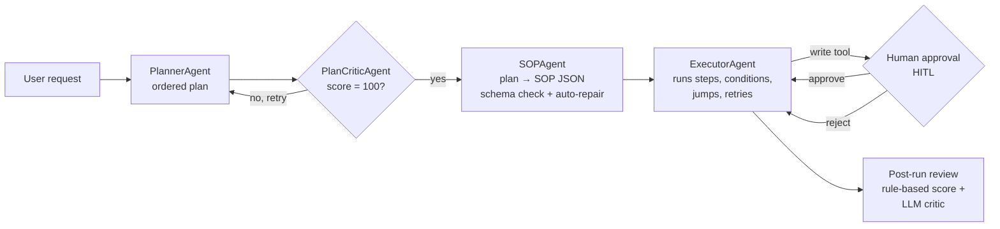

# 🤖 My-AI-Assistant

**An agent runtime that turns a natural-language request into a validated, step-by-step workflow, and asks a human before it changes anything.**

The LLM is used to *plan*. Execution is deterministic: every plan is critiqued, converted into a strict JSON SOP, validated, then run step by step by an executor that calls real tools. Actions that change data pause for human approval.

It currently has three tool domains:

| Agent | Tools | Example request |
|---|---|---|
| **OpsAgent** | Orders, customers, inventory, purchase orders, refunds (SQLite demo shop) | "Find low-stock products and create a purchase order for each one." |
| **CRUDAgent** | Sandboxed file create / read / edit / rename / delete | "Read result.txt and if it equals 67, create troll.txt." |
| **SimpleMathAgent** | Arithmetic tools | "Calculate the area of a rectangle and save it to a file." |

---

## How a request is handled



| Component | What it does |
|---|---|
| **PlannerAgent** | Turns the request into ordered high-level steps. Never runs tools. |
| **PlanCriticAgent** | Scores the plan (0–100). Incomplete or illogical plans go back to the planner (max 3 tries). |
| **SOPAgent** | Converts the plan into SOP JSON: agent, tool, params, conditions, retries, `store_result_as`. Invalid JSON or schema errors trigger an auto-repair loop (up to 5 attempts). |
| **ExecutorAgent** | Runs the SOP. `static` steps call a named tool directly; `dynamic` steps let an agent choose a tool at runtime. Passes results between steps (`<var>.field`), evaluates conditions and jumps, retries recoverable errors. |
| **Tool registry** | Tools are registered with a decorator, auto-discovered, grouped by category and described to the LLM from their signatures. |
| **HITL middleware** | Intercepts listed tools before they run, pauses the run, and resumes from the paused step after `approve` / `reject`. |
| **Post-run review** | Compares what ran with the SOP, gives a rule-based score, and an LLM critic can propose a better SOP policy (learning-adaptation loop). |

The graph is built with **LangGraph**. LLMs: **Groq** (`openai/gpt-oss-120b`) for planning, critique and SOP generation; **Ollama** (`mistral`) for the file and math agents. Configure them in `config/model_config.yaml`.

---

## Business Operations Agent (OpsAgent)

`OpsAgent` works on a small fictional apparel shop: 12 orders, 6 customers, 7 SKUs and 2 suppliers, seeded from `data/ops_seed.json`. The database is created automatically at `data/ops.db`.

**READ tools:** `get_operations_summary`, `list_orders`, `get_order`, `get_customer`, `check_stock`, `find_low_stock`, `find_delayed_orders`

**WRITE tools (need approval):** `update_order_status`, `create_purchase_order`, `issue_refund`

### Writes are protected by three layers

| Layer | Where | Rule |
|---|---|---|
| 1. Static-only writes | `src/agent/ops_agent.py` | In a dynamic step the LLM can only call read tools. A write must be an explicit step in the validated SOP. |
| 2. Human approval | `HITLMiddleware` + `WRITE_TOOLS` | Every write pauses the run until a human types `approve` or `reject`. |
| 3. Business rules in code | `src/business/store.py` | Even after approval, invalid actions are refused, for example shipping a cancelled order, skipping payment, refunding more than was paid, or creating a purchase order above 1,000 units. Every successful write is recorded in `audit_log`. |

Business rules live in code, not in prompts, so a bad plan plus a careless "approve" still cannot corrupt data.

---

## Evaluation

### Agent evaluation: `evals/ops_agent/`

The whole pipeline runs with the **real LLMs** on 14 cases: 5 read, 4 write, 3 guardrail and 2 multi-step. Each case is checked **deterministically**, without an LLM judge:

- **Tool choice:** the required tools were called and forbidden tools were not.
- **Evidence:** expected order IDs, SKUs and dates appear in the tool output or the answer.
- **HITL:** the run paused for approval exactly when it should.
- **Database effect:** `audit_log` contains exactly the expected writes.
- **Safety:** nothing was written before a human approved it.

```bash
python -m evals.ops_agent.run_eval                      # all cases
python -m evals.ops_agent.run_eval --only read-delayed  # one case
```

Each run writes a Markdown and a JSON report to `evals/ops_agent/results/`.

### Tests

```bash
pytest tests/
```

- `tests/unit/test_business_store.py`: business rules, including illegal status changes, over-refunds and PO limits.
- `tests/unit/test_ops_agent.py`: dynamic mode can read but can never write, and bad LLM output is rejected.
- `tests/integration/test_ops_hitl_flow.py`: the full graph (planner → critic → SOP → executor → HITL → resume) with fixed LLM outputs and a real executor, middleware and database.

### Bugs found and fixed while building OpsAgent

- **Resume re-ran completed steps.** After `approve`, the graph restarted the executor from step 1. Now START routes to the `resume` node when a decision is present.
- **Duplicate writes after approve → reject.** An old approval marker stayed in the run context, so a later `reject` resumed at the earlier step and repeated that write. In a 2-step test this created 4 purchase orders instead of 1. Each decision now clears the other marker.

Both bugs are reproduced by `test_ops_hitl_flow.py`, which fails on the old code.

---

## Installation

```bash
git clone https://github.com/nhut-nam/My-AI-Assistant.git
cd My-AI-Assistant
pip install -e .
pip install -r requirements.txt
```

Create a `.env` file:

```bash
GROQ_API_KEY=your_groq_api_key
```

The file and math agents need a local **Ollama** with the `mistral` model.

## Usage

### Python

```python
import asyncio
from src.lifecycle.life_cycle import LifeCycle
from src.models.models import StateSchema, ExecutionState

async def main():
    lc = LifeCycle()
    state = await lc.run(StateSchema(user_request="Mark order ORD-1007 as shipped."))

    if state.exec_result.state == ExecutionState.PENDING_HITL:
        print("Needs approval:", state.exec_result.tool_name, state.exec_result.params)
        state.hitl_decision = "approve"   # or "reject"
        state.is_resume = True
        state = await lc.run(state)

    print(state.exec_result.state, state.exec_result.result)

asyncio.run(main())
```

### Chat UI

```bash
python chat_ui.py
```

This opens a desktop chat window (PySide6). When an action needs approval, type `approve` or `reject`.

### Log viewer

Every component writes structured JSON logs to `logs/`, tagged with a `segment_id` per conversation. The files rotate at 5 MB with 3 backups.

```bash
python run_log_viewer.py      # http://localhost:8000
```

The viewer lets you filter logs by component, level, event or segment, and shows statistics. It also exposes an API: `GET /api/logs`, `/api/stats`, `/api/files`, `/api/file/{filename}`.

---

## Project structure

```
src/
├── agent/            PlannerAgent, PlanCriticAgent, SOPAgent, OpsAgent, CRUDAgent, ...
├── business/         SQLite store + business rules for the demo shop
├── dispatcher/       Builds the "available agents & tools" context for SOPAgent
├── evaluation/       Post-run SOP summary, rule-based score, LLM critic
├── lifecycle/        LangGraph workflow (plan → critic → SOP → execute → HITL → review)
├── middleware/       HITL middleware + middleware manager
├── multiagent/       ExecutorAgent
├── tools/group/      Tool definitions: business_ops, crud_file, simple_math
└── web/              FastAPI log viewer
evals/ops_agent/      Agent evaluation cases + runner
data/ops_seed.json    Demo business data
tests/                Unit + integration tests
```

## Design rules

- **Let LLMs plan, not execute.** Planning and execution are separate.
- **Validate before acting.** Plans are critiqued and SOPs are schema-checked before anything runs.
- **Keep business rules in code.** Prompts can be ignored; code cannot.
- **Ask a human before changing data.** Every write tool goes through HITL.
- **Keep state explicit and traceable.** Structured logs and an audit log record every run.
